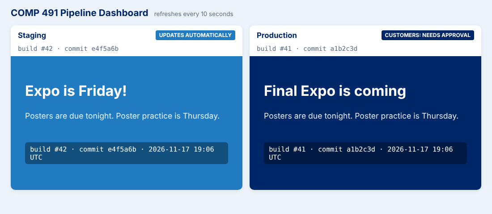

# COMP 491 Live Demo: "Same Build, Two Doors"

A 9 minute demo for the 40 minute DevOps + CI/CD lecture. Students already saw CI in the
GitHub Actions lecture (push, red X, fix, green check). This demo picks up where that
left off and shows what CD adds:

- **CI** checks every change (lint, tests, build). Students know this part.
- **Continuous Delivery** (Acts 2 and 3): every commit to `main` is automatically
  prepared and running on **staging**, but **production** gets it only after a person
  clicks Approve.
- **Continuous Deployment** (Act 4): remove the approval and every passing commit goes
  all the way to production.
- **Build once, promote:** staging and production show the same build number.

The wording follows Chapter 10.4.1 of the course textbook (softengbook.org): *delivery*
means preparing a version for release, and *deployment* means releasing it to customers.
Staging is where the prepared version lands; production is what customers see.

Students watch a live dashboard on their phones with staging and production side by side.
Staging changes on its own. Production waits until you approve it.

## What is in this repo

| File | Purpose |
|---|---|
| `site_config.json` | The headline, message and theme color you edit live |
| `src/site.py` | Validates the config and builds `site/` (page + `version.json`) |
| `tests/test_site.py` | pytest suite (bad colors, empty headline, HTML escaping, build output) |
| `.github/workflows/pipeline.yml` | One pipeline, three jobs: `ci` > `deploy-staging` > `deploy-production` |
| `dashboard/index.html` | The side-by-side page students watch; refreshes every 10 seconds |

## One-time setup (the day before, about 15 minutes)

Use a new **public** repo, not last time's `gh-actions-mac-demo`. Required reviewers on
environments are free for public repos, and the workflow runs on `ubuntu-latest`, so it
uses no paid minutes.

1. Create a public repo, e.g. `comp491-cd-demo`, and push these files to `main`.
   The first run deploys to both staging and production. That run also creates the
   `staging` and `production` environments and the `gh-pages` branch.
2. **Settings > Environments > production:** add yourself under **Required reviewers**.
   Leave "Prevent self-review" **unchecked** so you can approve your own deploy.
   Leave `staging` with no protection rules.
3. **Settings > Pages > Build and deployment:** Source = **Deploy from a branch**,
   Branch = `gh-pages`, folder `/ (root)`. Save.
4. After a minute or two, open `https://<your-user>.github.io/comp491-cd-demo/`. Both panels
   should show the same build number. Put a QR code to this URL on the demo slide.
5. Do one full practice run (Acts 2 and 3) so you know how long your runs take. Usually:
   CI about 30 seconds, then about a minute for each GitHub Pages update.
6. Before class, make sure staging and production show the **same** build number.

## Demo script

Have three tabs ready: the dashboard, the repo's **Actions** tab, and `site_config.json`.

### Act 1: The pipeline (1.5 min)
1. Students open the dashboard (QR code). Both panels match.
2. Open `pipeline.yml` and only point at the three job names. "The `ci` job is what you saw
   in the GitHub Actions lecture. Today is about the two jobs after it."
3. Point at `environment: production`. "This one line, plus a setting, is the difference
   between Delivery and Deployment."

### Act 2: Automatic delivery to staging (3 min)
1. On GitHub, edit `site_config.json` in the browser (pencil icon). Ask the class to pick a
   new headline and color, e.g. `"headline": "Expo is Friday!"`, `"theme_color": "#207BC1"`.
   Commit directly to `main`.
2. Switch to the Actions tab and open the run. Show the graph: `CI` > `Deploy to staging` >
   `Deploy to production`.
3. While CI runs, ask: "Nobody has clicked anything. Where will this change show up?"
4. Staging deploys on its own. About a minute later the **staging** panel on everyone's
   phone changes color. **Production does not change.**
5. Back on the graph, `Deploy to production` says **Waiting**. "Every change that passes CI
   is automatically prepared and running on staging, ready to release. In the book's
   terms, that is *delivery*. Customers on production have not seen it yet."

### Act 3: Approve the deployment = Continuous Delivery (2 min)
1. "Production is one click away, but a person decides when. That is Continuous
   **Delivery**: the book's release manager authorizing the deployment." Ask the class:
   should we ship it? Let them vote.
2. Click **Review deployments** > check `production` > **Approve and deploy**.
3. Within a minute or two, the production panel updates.
4. Point at the build numbers: **the same build # on both**. "We did not rebuild for
   production. We promoted the exact artifact we tested on staging. Build once, promote."

### Act 4: Remove the gate = Continuous Deployment (2.5 min)
1. **Settings > Environments > production:** remove yourself as a required reviewer. Save.
2. Make a second edit to `site_config.json` (new message or color) and commit.
3. This time the run goes `CI` > `staging` > `production` with no stop. Both panels change,
   one after the other.
4. "Every passing commit now reaches customers automatically. That is Continuous
   **Deployment**. Same YAML, same tests; the only difference is that gate. Remember the
   book's printer driver example: who should keep the gate? A bank? A hospital portal?
   Your capstone?"
5. After class: add the required reviewer back.

### If there is time: CI still guards both doors (30 sec)
Set `"theme_color": "purple"` and commit. CI fails on validation, and neither panel changes.
Revert the change afterward.

## Backup plan (slow Wi-Fi or slow GitHub)
- GitHub Pages updates can take a couple of minutes. Fill the wait with the Act 2 and Act 3
  questions. Leave the dashboard on the projector; it refreshes on its own.
- Show `docs/dashboard-example.png` (staging ahead of production) if Pages is slow.
- The night before, take screenshots of the run graph showing **Waiting**, the
  **Review deployments** dialog, and both panels after approval.
- Run it locally: `pip install -r requirements-dev.txt`, `pytest -v`, `python -m src.site`,
  then open `site/index.html`.

## How this differs from the GitHub Actions lecture demo
| GitHub Actions demo | This demo |
|---|---|
| One job: run the tests | Three jobs: CI, staging, production |
| Outcome: red X or green check | Outcome: a live site changes (or waits) |
| Answers "is the code correct?" | Answers "how does correct code reach users, and who decides?" |
| macOS runner | Ubuntu runner (cheaper, the common default) |
